# deckcheck for VS Code: user manual

deckcheck checks keyword decks for LS-DYNA while you edit them in VS Code. It finds mistakes that would stop a run
or quietly change it: references to ids that don't exist, ids defined twice, values that don't fit their field,
missing include files, and definitions nothing uses. It reads the deck only. It never runs the solver and makes no
physics judgments.

> **Status: version 0.1.0, a work in progress.** It works and is tested, but it is not yet on the extension stores.
> See the [roadmap](../roadmap.md) for what is coming next. Screenshots were taken with VS Code 1.144 on Windows.

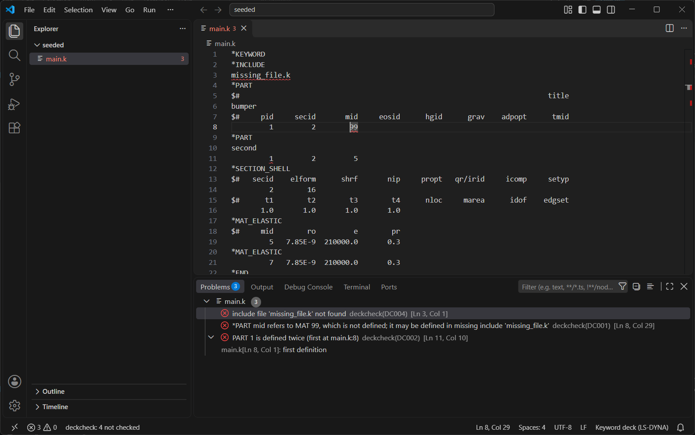

## Contents

1. [Install](#1-install)
2. [Your first check](#2-your-first-check)
3. [Models, not files](#3-models-not-files)
4. [Small models and big models](#4-small-models-and-big-models)
5. [The status bar](#5-the-status-bar)
6. [Commands](#6-commands)
7. [Settings](#7-settings)
8. [Reading a finding](#8-reading-a-finding)
9. [It stays out of your way](#9-it-stays-out-of-your-way)
10. [Troubleshooting](#10-troubleshooting)
11. [Command line and other editors](#11-command-line-and-other-editors)
12. [Known limits](#12-known-limits)

## 1. Install

### 1.1 Python

deckcheck needs Python 3.11 or newer on your computer, and nothing else: deckcheck itself ships inside the
extension. To see which Python you have, open a terminal and type:

```
py -3 --version        (Windows)
python3 --version      (macOS, Linux)
```

If the version is below 3.11, or the command is not found, install Python from [python.org](https://www.python.org/downloads/).
deckcheck uses, in this order: the `deckcheck.interpreter` setting, the Python extension's interpreter if you have
that extension, then `py -3` or `python3` on your PATH.

### 1.2 The extension

**After the first release:** open the Extensions view (Ctrl+Shift+X), search for **deckcheck** and click Install.

**Until then**, install it from a `.vsix` file, either way:
- In VS Code: Command Palette (Ctrl+Shift+P) > **Extensions: Install from VSIX...** and pick the file.
- In a terminal: `code --install-extension deckcheck-0.1.0.vsix`

If VS Code was open while you installed, reload the window once (Command Palette > **Developer: Reload Window**).
An open window doesn't start a newly installed extension.

### 1.3 Check that it works

Open any `.k`, `.key` or `.dyn` file. At the bottom right, the language reads **Keyword deck (LS-DYNA)** (not
"Plain Text"), and at the bottom left a **deckcheck** item appears in the status bar.

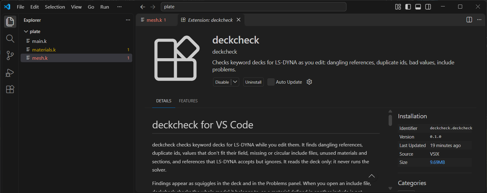

## 2. Your first check

Open a folder that holds your deck (File > Open Folder), then open the deck. Problems are underlined where they
are: red for errors, yellow for warnings. Rest the mouse on an underline to read the finding.

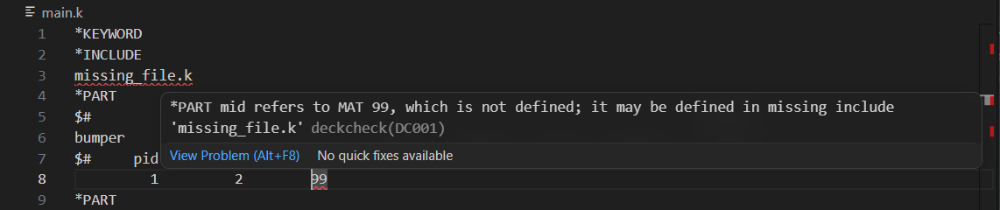

Every finding is also listed in the **Problems** panel (Ctrl+Shift+M), grouped by file. Click a line there to jump
to it. F8 and Shift+F8 step through the findings in the open file.

A finding that points somewhere else (here, the first definition of a duplicate part) shows that place under the
finding; click it to go there.

## 3. Models, not files

A real model is spread over many files: a main deck that includes the mesh, the materials, the contacts. deckcheck
checks the **whole model**, not just the file in front of you. Open `mesh.k` alone and a material defined in
`materials.k` is still found.

Here the part in `mesh.k` refers to material 9, which no file in the model defines. deckcheck reports the
missing material in `mesh.k`, and, as a consequence, material 1 in `materials.k` is now unused:

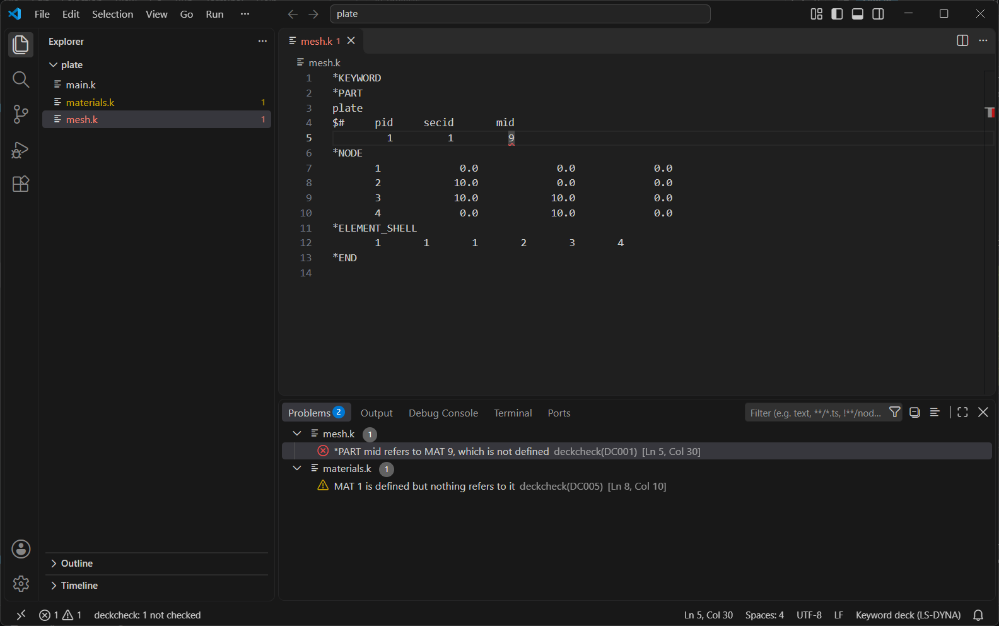

**How deckcheck finds the model.** It looks at every deck file in the folder you opened. A deck that no other deck
includes is a **main deck**; each main deck and everything it includes, the way LS-DYNA follows `*INCLUDE` and
`*INCLUDE_PATH`, is one model. If the folder holds decks that are not models (old copies, templates), list the real
main decks in the `deckcheck.mainDecks` setting, or leave the others out with `deckcheck.exclude`
([Settings](#7-settings)).

## 4. Small models and big models

**A small model** (one whose full check takes under 2 seconds) is re-checked as you type. Squiggles follow your
edits within about half a second, before you save.

**A big model**, such as a full vehicle, is never checked just because you opened it, so opening a file stays as
fast as without deckcheck. The status bar says so:

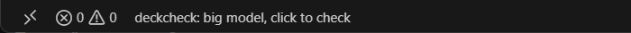

To check it, click the status bar item and choose **Check this model now**, or save any file of the model. The
status bar counts the seconds against an estimate; after a click, a message also confirms the check has started.
Keep working meanwhile: the check runs in a separate, low-priority process.

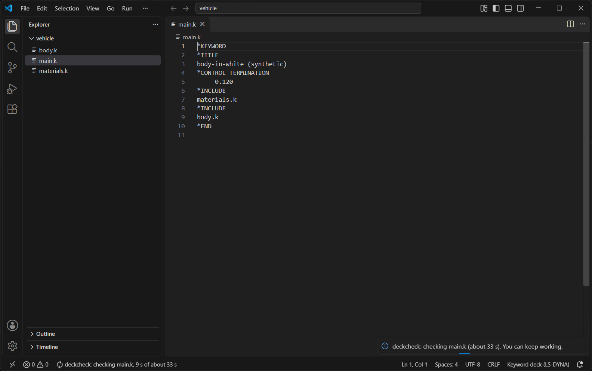

Clicking again while it runs does not restart it; deckcheck tells you how long is left:

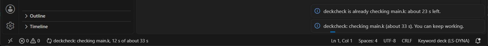

When it ends, a message says what was checked (the main deck and how many included files, their size, the time)
and what was found. **Show Problems** opens the list.

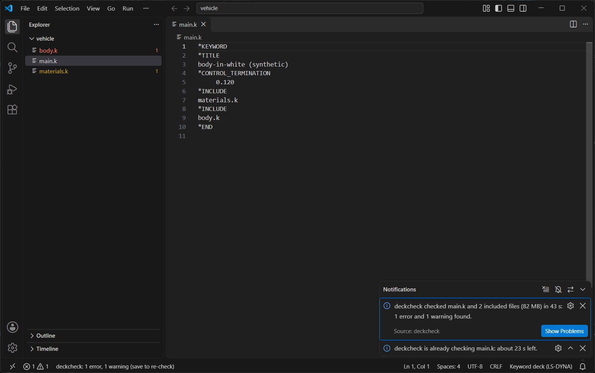

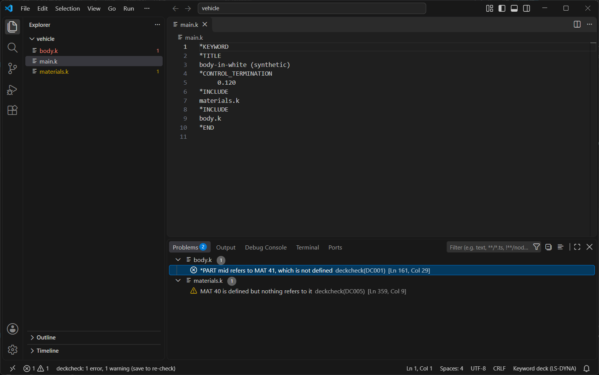

After you edit a big model, the status bar says **edited, save to check**. Save, and the model is checked again.

**Very large files.** The extension doesn't copy files over 20 MB out of the editor (`deckcheck.maxSyncMB`).
deckcheck reads those from disk, so a check sees their saved version. If one of them has unsaved edits, **Check this
model now** offers to save it first.

## 5. The status bar

The deckcheck item at the bottom left always describes the model of the file in front of you.

| Status bar text | Meaning |
|---|---|
| `deckcheck` | The model was checked completely. |
| `deckcheck: 1 not checked` | Checked, but some part couldn't be. Click it to see what and why ([section 8](#not-checked)). |
| `deckcheck: big model, click to check` | A big model, not checked yet. Click, then **Check this model now**, or save. |
| `deckcheck: checking main.k, 12 s of about 33 s` | A check is running. |
| `deckcheck: 1 error, 1 warning (save to re-check)` | A big model's last check result. |
| `deckcheck: no problems (save to re-check)` | A big model's last check found nothing. |
| `deckcheck: edited, save to check` | You edited a big model; save to check it again. |
| `deckcheck: starting` | Finding Python and starting up; a few seconds. |
| `deckcheck: paused` | Paused for this workspace, or `deckcheck.enable` is off. |
| `deckcheck: paused (needs more than 2048 MB)` | The model needs more memory than allowed; see [Troubleshooting](#10-troubleshooting). |
| `deckcheck: no Python` | No Python 3.11 or newer was found; see [Install](#11-python). |
| `deckcheck: stopped` | deckcheck stopped after repeated failures. **Show output** has the details. |

Click the item for its menu:

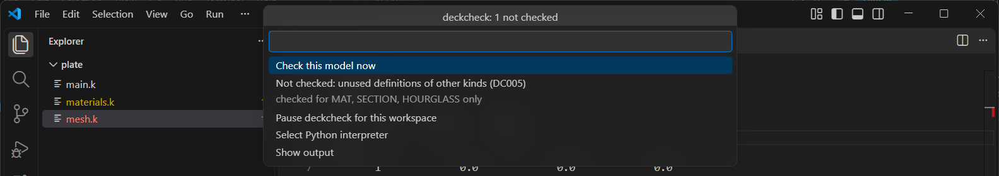

## 6. Commands

All commands are in the Command Palette (Ctrl+Shift+P); type `deckcheck`.

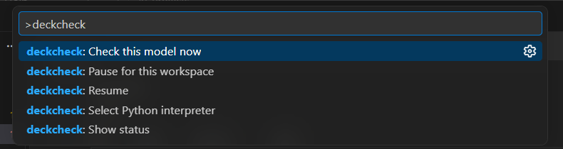

| Command | What it does |
|---|---|
| **Check this model now** | Checks the model of the current file, whatever its size. |
| **Pause for this workspace** | Stops deckcheck in this workspace and clears its squiggles. Stays paused after a restart. |
| **Resume** | Starts it again; the squiggles come back by themselves. |
| **Select Python interpreter** | Picks the Python that runs deckcheck (saved as `deckcheck.interpreter`). |
| **Show status** | The status bar menu above. |

## 7. Settings

Open Settings (Ctrl+,) and search `@ext:deckcheck.deckcheck`, or edit `settings.json`.

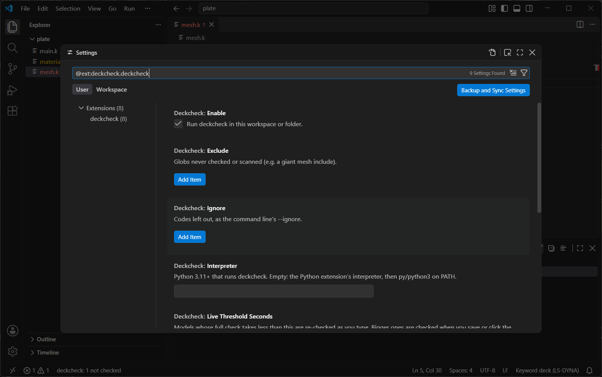

| Setting | Default | Meaning |
|---|---|---|
| `deckcheck.enable` | `true` | Turn deckcheck off for a workspace or folder. |
| `deckcheck.exclude` | `[]` | Globs for files never checked or scanned, such as old copies. |
| `deckcheck.mainDecks` | `[]` | The main decks, relative to the folder. Overrides detection. |
| `deckcheck.interpreter` | `""` | The Python 3.11+ that runs deckcheck. Empty: found automatically. |
| `deckcheck.liveThresholdSeconds` | `2` | Models whose full check is faster than this are checked as you type. |
| `deckcheck.maxSyncMB` | `20` | Files larger than this are read from disk and checked when saved. |
| `deckcheck.memoryMB` | `2048` | deckcheck pauses itself above this memory use. |
| `deckcheck.ignore` | `[]` | Codes to leave out, such as `"DC005"`. |

An example `.vscode/settings.json` for a project folder:

```json
{
  "deckcheck.mainDecks": ["run/main.k"],
  "deckcheck.exclude": ["archive/**", "**/*_old.k"],
  "deckcheck.ignore": ["DC005"]
}
```

## 8. Reading a finding

Each finding has a message, a severity and a code. The message states a fact about the deck: what refers to what,
and what is missing.

| Code | Severity | What it finds |
|---|---|---|
| DC001 | error | A reference to an id that is never defined, or a required reference left blank or 0. |
| DC002 | error (warning where LS-DYNA accepts it) | The same id defined twice. |
| DC003 | warning | A value of the wrong type for its field, a tab in a card, cards past the end of a keyword, a definition with a blank or 0 id. |
| DC004 | error | An include file that can't be found, or an include that includes itself. |
| DC005 | warning | A material, section or hourglass control that nothing refers to. |
| DC006 | warning | A reference LS-DYNA accepts without checking, to an id that doesn't exist, so it has no effect. |
| DC000 | warning | deckcheck could not read a block. The rest is still checked. Please report it. |

**Errors and warnings follow what LS-DYNA does.** An error means LS-DYNA would stop with an error. A warning means
LS-DYNA would run, but the effect is surprising or there is none. Which is which was decided by running LS-DYNA on a
small test deck for each pattern, never assumed.

**A finding you mean to keep** (a placeholder material kept on purpose, for example) can be left out by code with
`deckcheck.ignore`. Suppressing a single line is planned.

<a id="not-checked"></a>**"Not checked."** deckcheck would rather say nothing than guess. When it can't see
everything a check needs, it stays silent on that part and says so. The status bar shows how many items, and its
menu lists each one with the reason. For example:
- an include file is missing, so a material defined only there can't be confirmed as unused;
- a keyword deckcheck doesn't know yet;
- a `*PARAMETER` it can't resolve.

## 9. It stays out of your way

deckcheck must never make opening, scrolling or editing a deck worse. Every release is measured on the 1 GB CCSA
Toyota Yaris model:
- Opening a file with deckcheck on is at most 10 % slower, or at most 20 ms slower, than with it off.
- The extension starts in under 100 ms (measured: under 2 ms).
- Editor commands stay under 100 ms while a full vehicle is checked (measured: about 1 ms).

It never takes part in drawing the file. Its work runs in a separate, low-priority process with a memory budget.
The [project README](../../README.md#do-no-harm-measured) has the measurements and why the rule is set where it is.

## 10. Troubleshooting

| What you see | What to do |
|---|---|
| No deckcheck item in the status bar, and the language says "Plain Text" | Reload the window once (Command Palette > **Developer: Reload Window**). An open window doesn't start a newly installed extension. |
| `deckcheck: no Python` | Install Python 3.11 or newer, or point **deckcheck: Select Python interpreter** at one. |
| `paused (needs more than 2048 MB)` | The model needs more memory. Click **Raise the limit** in the message, or set `deckcheck.memoryMB` higher. |
| A big model was edited but the squiggles didn't change | Big models are checked on save: save, or click the status bar > **Check this model now**. |
| A finding still shows after you fixed it in a file over 20 MB | That file is read from disk: save it. |
| An include file is reported as missing but it exists | Check the path relative to the deck that includes it, and any `*INCLUDE_PATH`. LS-DYNA would not find it either. |
| A file in the folder is checked as its own model when it shouldn't be | Set `deckcheck.mainDecks`, or exclude the file with `deckcheck.exclude`. |
| Something looks wrong | Status bar > **Show output** has deckcheck's log. Please report it with that log; leave out deck contents you can't share. |

## 11. Command line and other editors

deckcheck also runs from a terminal, with the same checks: `deckcheck main.k`. It suits scripts and CI (text or
JSON output, exit code 1 on errors). See the [project README](../../README.md#usage).

Other editors are not supported yet. A tested recipe for Notepad++ (run the command line, jump to the findings) is
on the [roadmap](../roadmap.md). Editors that speak the Language Server Protocol (Neovim, Sublime Text, Emacs,
JetBrains) can probably use deckcheck's server, but that is untested.

## 12. Known limits

- No physics checks: units, time step, contact settings and material sanity are not checked yet.
- Long-format decks (`*KEYWORD LONG=Y`) are only partly read; the affected blocks are listed as not checked.
- Unused-definition warnings cover materials, sections and hourglass controls only.
- Remote, WSL and Codespaces workspaces are untested.
- A check can't be cancelled once started; **Pause** stops it.

The full list is in the [project README](../../README.md#known-limits).
